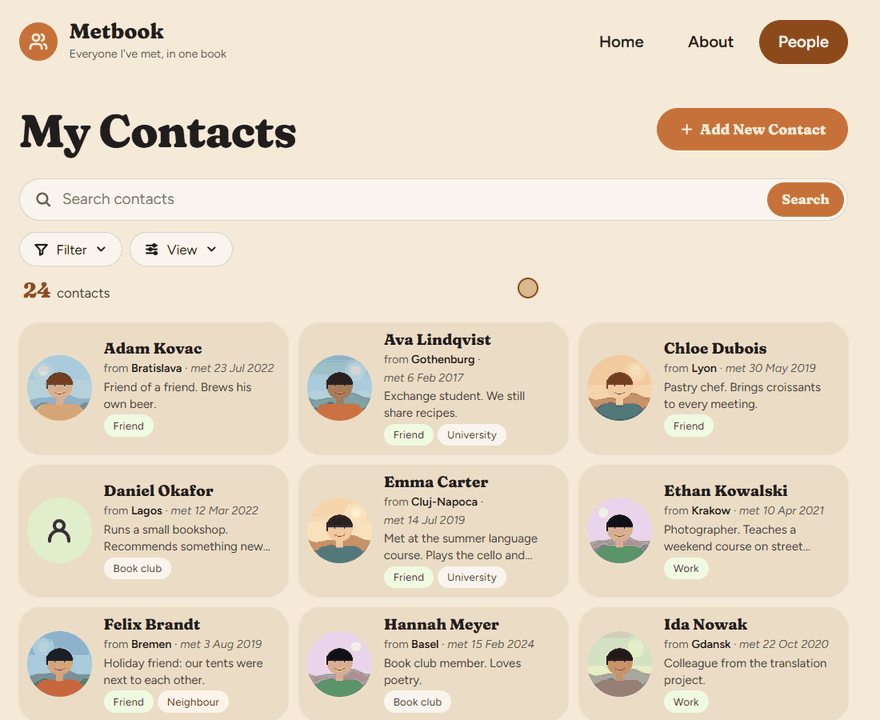
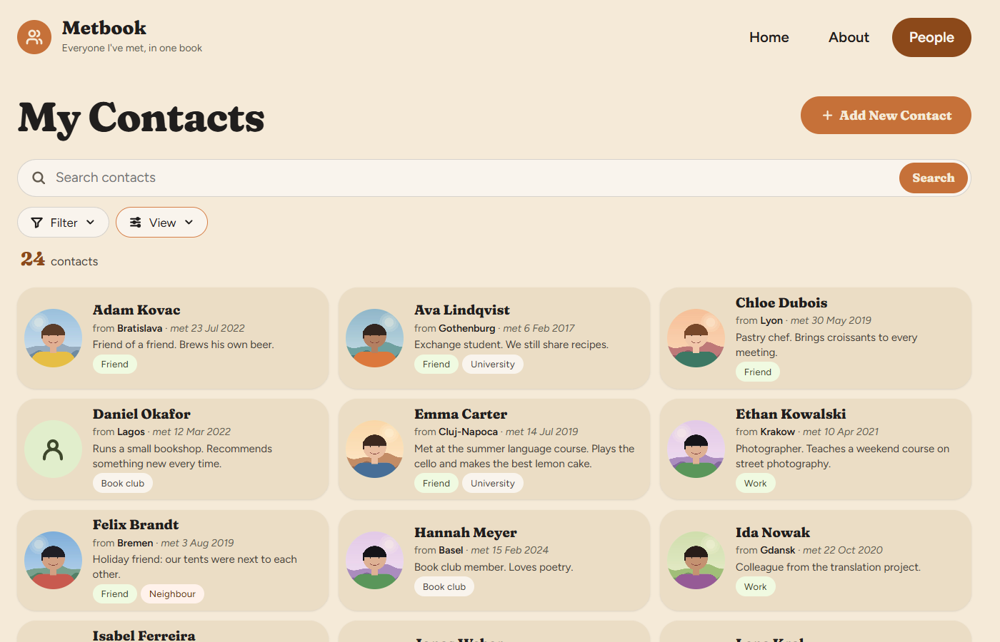
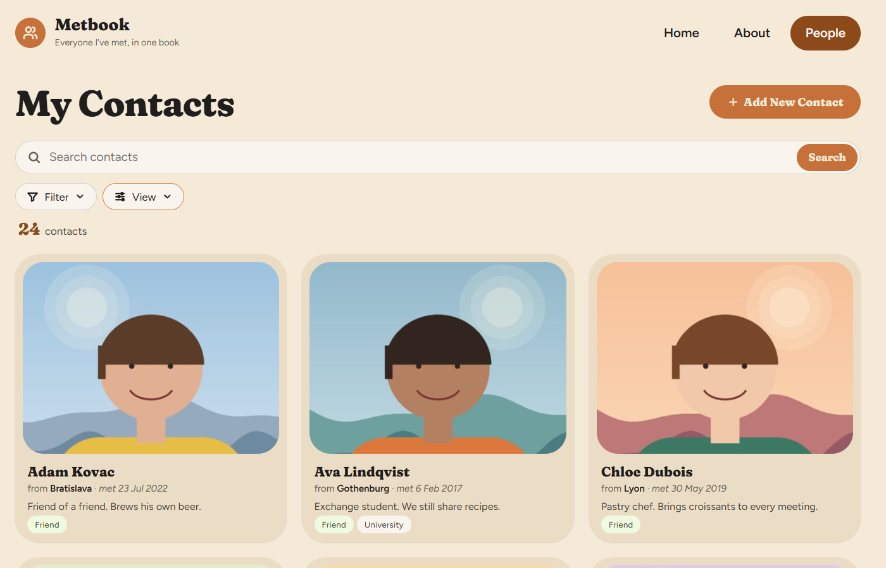
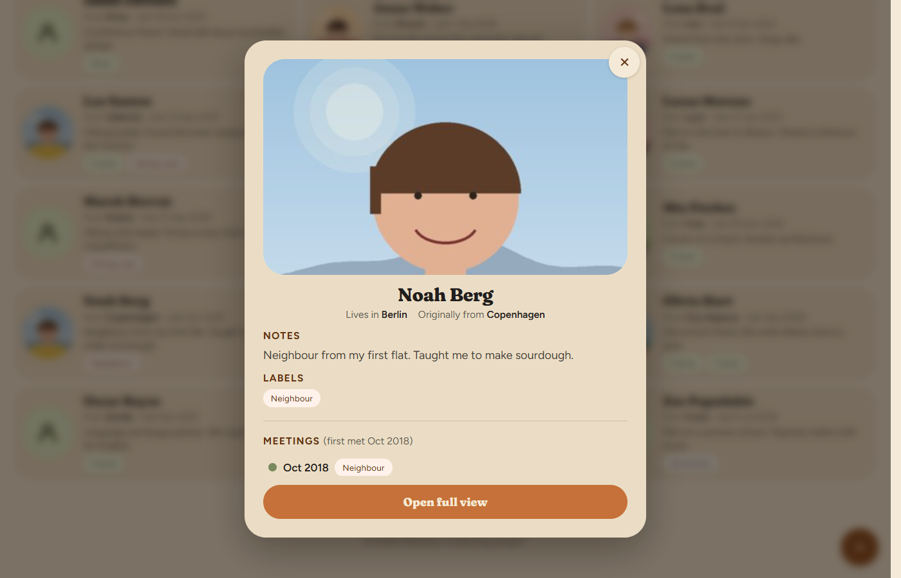
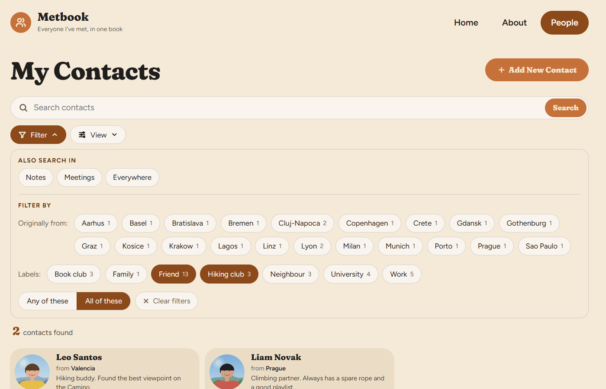
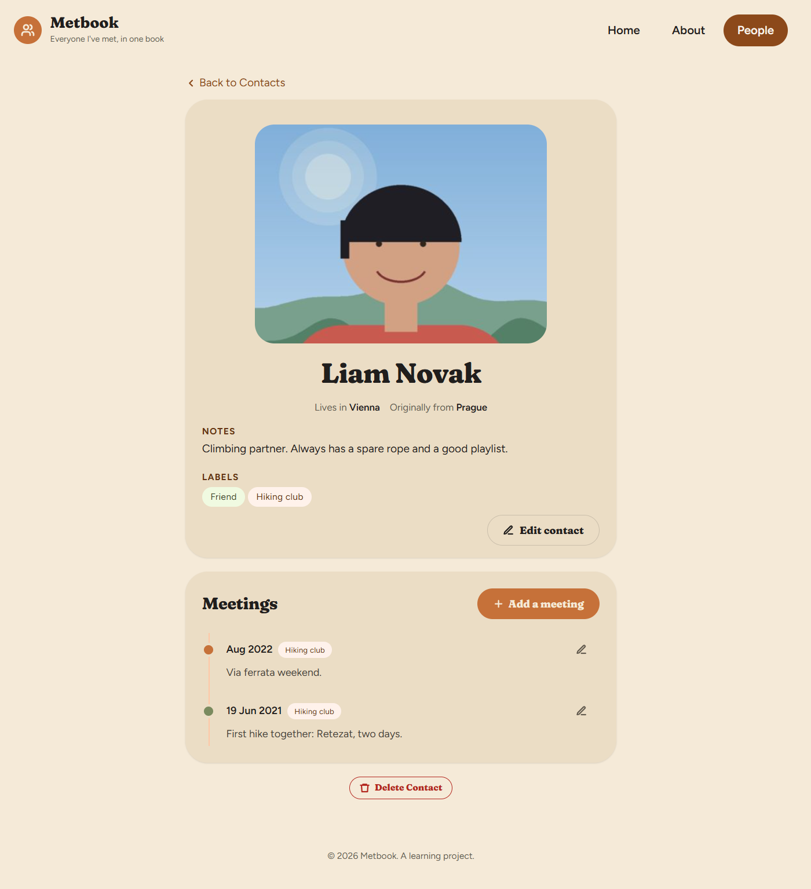
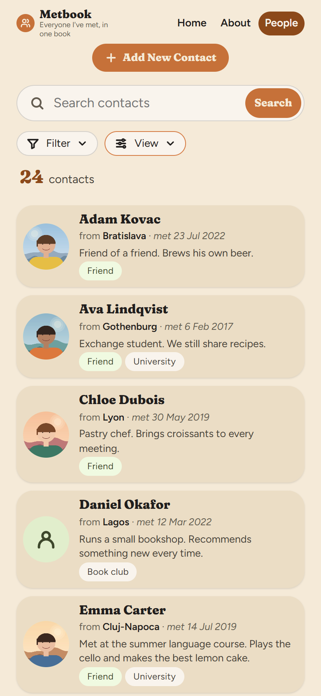
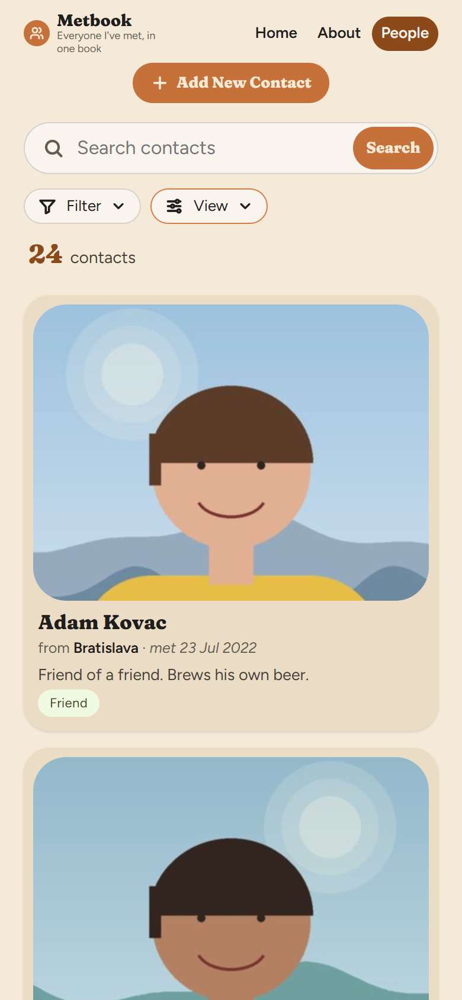

# Metbook

*Everyone I've met, in one book.*

Metbook is a small personal contacts app, built with Flask and SQLite. It keeps track of the people you meet:
who they are, where they live, where they come from, and **when you met** — a timeline of meetings for every person,
with notes about each meeting (for example where it was and what happened).

It is a learning project, made for personal use, and runs on your own computer. Your data stays in a local database file.

## About this project

All of the code of this project was written by **Claude Code** (on the Claude Pro plan), and the look of the app
was partly designed with **Claude Design**. The app uses Flask and Pillow, and third-party fonts. I came up with the
idea, decided how it should look and work, tested every change, and asked for the next one — one small feature at a time.

This project was good for me for the following reasons:

0. **A 4-year-old app idea:** a small place to remember why I know someone, when and where we met,
   and a few basic facts about them, so that I don't forget people. And to see which people I met in the last months,
   in the order we met.
1. **Getting to know Claude Code:** how to describe what I want, how to check the result, and how to ask for changes.
2. **Getting started with Git:** the basics — commits, history and pushing to GitHub.
3. **Experiencing how an app is built from the start,** one feature at a time, instead of everything at once.
4. **Getting a picture of the big parts** of an app like this: the database, the server, the pages, the styles and the scripts.
5. **Finding out that I can download my own data from Facebook.** I filled my database with the friends from my
   Facebook export (the `import_friends.py` script reads the downloaded file and adds the people, with the date we
   became friends).
6. **Seeing how a phone can connect to an app on my computer:** both are on the same Wi-Fi, and the phone opens the
   computer's address in its browser (`phone.bat` starts the app for this).
7. **An observation:** while building this app I noticed that I could not think of a popular online service whose main
   focus is giving an overview of one relationship with one person over time. This is not good or bad, it is just
   what I noticed. For example, Snapchat keeps streaks (the fire symbol), which count how many days in a row two
   people have sent each other snaps, but that is not an overview of the relationship.

## Demo

All people and pictures in the demos and screenshots are invented.

**Search as you type** — the list narrows with every letter; "Also search in" adds the notes.


**Filter by labels** — choose labels (any of / all of them), press Search, and remove a filter with one tap.



**Moving around** — open a card for a quick look, open the full page, come back to the same place, change the layout.


**Scrolling** — down the list of people, into a contact's page (notes, labels and the timeline of meetings), and back to the same spot in the list.


## Screenshots

| | |
|---|---|
|  |  |
| *The list, compact layout* | *The list, large layout* |
|  |  |
| *Quick view: click a card* | *Filter by labels and places* |

A contact's page, and the phone layouts:



| Compact | Large |
|---|---|
|  |  |

## What it can do

- **People list** with live search (as you type), filters and two card layouts: *Compact* (small round picture) and *Large* (big picture).
- **Search in:** names (always), notes, meetings, or everywhere. Names and accents are matched loosely ("matyas" finds "Mátyás").
- **Filter by** the place a person comes from and by **labels** (any of / all of).
- **Contact page** with picture, places, notes, labels and a **timeline of meetings**. Each meeting has a date, notes, labels and photos.
- **Quick view** popup: click a card to see the details without leaving the list.
- **Pictures** can be moved inside their frames, so the face stays visible in the cards and the popup.
- **Add / edit / delete** contacts and meetings. Dates may be a full day, a month, or only a year.
- **Backup** page, and a script that imports a list of friends.
- **Works on a phone** (same Wi-Fi), with a layout of its own.

## Run it

You need Python 3.

```bash
python -m venv .venv
.venv\Scripts\pip install -r requirements.txt
.venv\Scripts\python app.py
```

Then open <http://127.0.0.1:5000>.

To use it on a phone on the same Wi-Fi, run `phone.bat` instead, and open the computer's address (port 5000) in the phone's browser.

## Project layout

| Path | What it is |
|---|---|
| `app.py` | The web app: pages (routes) and their logic |
| `database.py` | The SQLite database: tables, queries, search |
| `templates/` | The HTML pages (Jinja templates) |
| `static/` | CSS, JavaScript and fonts |
| `uploads/` | Uploaded pictures (not in the repository) |
| `contacts.db` | Your data (not in the repository) |

## Privacy

The database (`contacts.db`), the uploaded pictures and the friends import file are listed in `.gitignore`,
so they are never pushed to GitHub.
